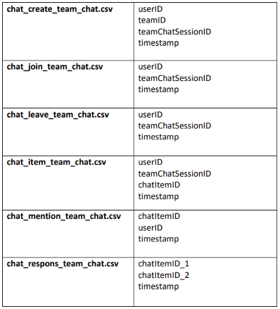

# Graph Analytics on Team-Chat Data with Neo4j


Big Data course project (team of 5). We load team-chat event logs into **Neo4j**, model users, teams and messages as a graph, and use Cypher plus the Graph Data Science library to find influential users and communities.


## What we did

- **Ingestion:** load six CSV event logs (team creation, join, leave, chat item, mention, reply) with `LOAD CSV` ([Neo4j/load_data.cypher](Neo4j/load_data.cypher))
- **Graph modelling:** users, teams and chat items as nodes; membership, authorship, mentions and replies as relationships
- **Analysis** ([Neo4j/analyst_data.cypher](Neo4j/analyst_data.cypher)):
  - most active users and teams
  - **PageRank** (`gds.pageRank`) to rank influential users in the mention/reply network
  - **Label Propagation** (`gds.labelPropagation`) for community detection
- **Visualisation** in Neo4j Browser

## Data



## Repository layout

```
data/      Raw chat event logs (CSV)
Neo4j/     Cypher scripts: load_data.cypher, analyst_data.cypher
docs/img/  Figures
Report.pdf Full report
```

## Run

1. Start Neo4j 5 with the Graph Data Science plugin and copy `data/*.csv` into its `import/` folder.
2. Run `Neo4j/load_data.cypher`, then the queries in `Neo4j/analyst_data.cypher`.

📄 [Report](Report.pdf) · 🎞️ [Slides](https://www.canva.com/design/DAGYauaAPKs/OyvuXBGi9xO2_bxaVBQKfQ/view?utm_content=DAGYauaAPKs&utm_campaign=designshare&utm_medium=link2&utm_source=sharebutton)

## Team

| Member | Contribution |
|---|---|
| Nguyễn Mạnh Hùng | Graph analysis with Neo4j |
| Vũ Đình Thọ | Graph analysis with Neo4j |
| Đinh Văn Sinh | PageRank and Label Propagation research |
| Nguyễn Công Thành | Slides: Big Data, NoSQL, Neo4j |
| Nguyễn Tuấn Thành | Conclusion and future work |
